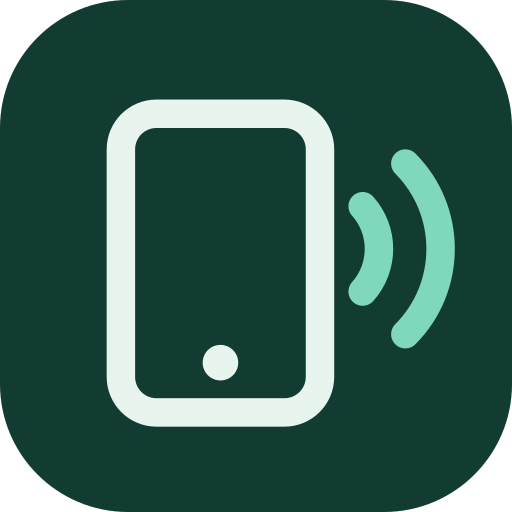
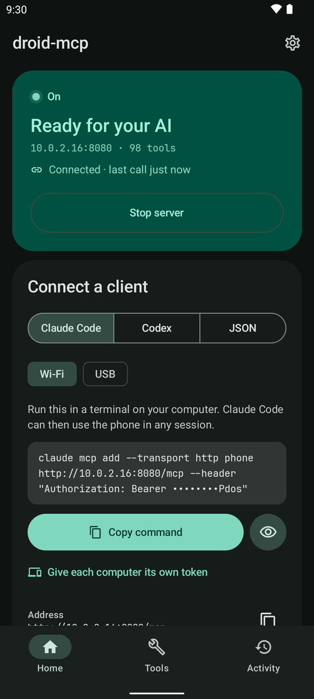
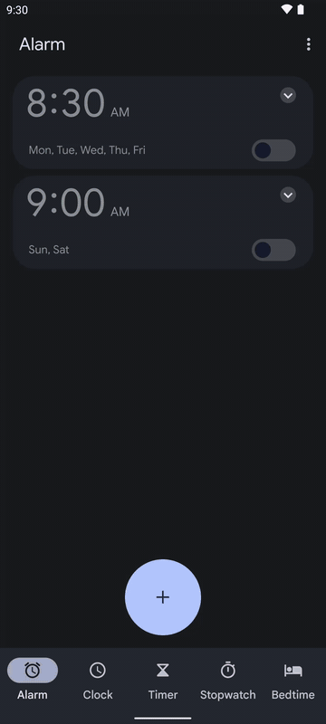

<p align="center"></p>

<h1 align="center">droid-mcp</h1>

<p align="center">
  <b>Let an AI use your Android phone.</b><br/>
  An app and an SDK that turn calendar, contacts, SMS, files, camera, notifications, screen control and more
  into <a href="https://modelcontextprotocol.io">MCP</a> tools for Claude, Codex, Cursor or an on-device model.
</p>

<p align="center">
  <a href="https://github.com/stixez/droid-mcp/actions/workflows/ci.yml"></a>
  <a href="https://jitpack.io/#stixez/droid-mcp"></a>
  <a href="https://stixez.github.io/droid-mcp/"></a>
  
  
  <a href="https://buymeacoffee.com/stixe"></a>
</p>

---

Three ways to use it:

- **The app:** install it, allow what you're comfortable with, and connect Claude Code, Codex or Cursor. [No code needed](#use-your-phone-from-claude-code).
- **SDK, on-device:** your app runs a local model that calls the tools directly.
- **SDK, MCP server:** your app runs an HTTP server on the phone that any MCP client can reach over Wi-Fi.

There are 160+ tools in 50+ modules, each with only its own permissions. See [all tools](docs/TOOLS.md).

## Use your phone from Claude Code

1. **Install the app.** Download `droid-mcp-<version>-arm64-v8a.apk` from the [latest release](https://github.com/stixez/droid-mcp/releases/latest) (older 32-bit phones: `armeabi-v7a`). [Obtainium](https://github.com/ImranR98/Obtainium) can keep it updated.
2. **Allow what clients may use.** The setup screen explains each permission and how many tools it unlocks. Only notifications are needed.
3. **Start the server and copy the command** into a terminal on your computer:

   ```bash
   claude mcp add --transport http phone http://192.168.1.20:8080/mcp --header "Authorization: Bearer <token>"
   ```

   The same card has config for Codex and JSON for other clients. Phone and computer must share a Wi-Fi, or use USB with `adb forward tcp:8080 tcp:8080`.

Then ask *"What's on my calendar today?"*

<p align="center">
  
</p>

The app asks you before a client sends, deletes or changes anything (once, for an hour, or always), logs every call, can give each computer its own token, and can pause itself off your home Wi-Fi. It isn't on Google Play, whose policies don't allow AI control through accessibility or SMS access.

<p align="center">
  
  
</p>

For steps only you should do, the agent can point at the right spot on your screen and wait until you've done it (`guide_user`, the clip on the right). Your taps go through to the app underneath.

## Use the SDK

```kotlin
// settings.gradle.kts
dependencyResolutionManagement {
    repositories { maven { url = uri("https://jitpack.io") } }
}

// build.gradle.kts: pick modules, or droid-mcp-all for everything except the opt-in ones
dependencies {
    implementation("com.github.stixez.droid-mcp:droid-mcp-core:0.14.0")
    implementation("com.github.stixez.droid-mcp:droid-mcp-calendar:0.14.0")
}
```

Call tools from an on-device model:

```kotlin
val mcp = DroidMcp.builder()
    .addTools(CalendarTools.all(context))
    .build()

val toolsJson = mcp.listToolsJson()      // hand this to the model
val result = mcp.callTool("read_calendar", mapOf("start_date" to "2026-10-01"))
```

Or serve them to desktop clients:

```kotlin
val mcp = DroidMcp.builder()
    .addTools(CalendarTools.all(context))
    .enableHttpServer(context = context)  // port 8080, token generated
    .build()
mcp.startServer()
val token = mcp.serverToken
```

Calls run off the main thread with a timeout. Beyond that, the builder can:

- ask the user before risky calls (`confirmToolCalls`)
- serve resources and prompts
- enable HTTPS (`enableTls`)
- go read-only (`readOnly = true`)

[Connecting clients](docs/PAIRING.md) covers tokens, sessions and TLS.

<details>
<summary>Packaging error about duplicate <code>META-INF</code> files?</summary>

```kotlin
android {
    packaging {
        resources {
            excludes += setOf(
                "META-INF/INDEX.LIST",
                "META-INF/io.netty.versions.properties",
                "META-INF/LICENSE.md",
                "META-INF/NOTICE.md",
                "META-INF/license/**",
                "META-INF/versions/9/OSGI-INF/MANIFEST.MF", // droid-mcp-tls only
            )
        }
    }
}
```

</details>

### Modules

| Area | Modules |
|------|---------|
| Personal data | `calendar` `contacts` `sms` `calllog` `media` `files` `downloads` `clipboard` |
| Device | `device` `screen` `settings` `sensors` `health` `biometric` `keyguard` `flashlight` `vibration` `audio` `usb` `wallpaper` `ringtone` `dnd` |
| Connectivity | `network` `wifi` `bluetooth` `telephony` `nfc` `location` `web` |
| Camera & vision | `camera` `screenshot` `qr` `mlkit` |
| Apps & intents | `apps` `alarms` `intent` `print` `tts` `playback` |
| Notifications | `notifications` `notifications-reply` `notification-watch` |
| UI automation | `accessibility` `ime` `overlay` |
| Opt-in | `shizuku` `root` ([shell tools](docs/SHELL.md)), `audit`, `tls`, `server-service` |

Your app requests permissions; the library never does. Each module has `requiredPermissions()` and `hasPermissions(context)`, and some need special access granted in Settings ([which ones](docs/TOOLS.md#special-access)).

## Security

The server needs a bearer token and checks Origin, sessions and body size. File tools stay in shared storage, and web tools refuse private addresses. It listens on every network the phone joins, so use trusted networks or TLS. See the [security model](docs/SECURITY.md). droid-mcp sends no analytics; ML Kit (`mlkit`, `qr`) reports usage to Google.

## Requirements

Android 9 (API 28)+ at runtime; `compileSdk` 36+, AGP 8.9.1+ and Kotlin 2.3+ to build.

## Documentation

| | |
|---|---|
| [Tools](docs/TOOLS.md) | Every tool, its parameters and permissions |
| [Connecting clients](docs/PAIRING.md) | Tokens, sessions, mDNS, TLS |
| [Security](docs/SECURITY.md) | Threat model and what the host app owns |
| [Shell tools](docs/SHELL.md) | Shizuku and root |
| [Versioning](docs/VERSIONING.md) | How releases change things |
| [API reference](https://stixez.github.io/droid-mcp/) | KDoc |

`sample-app` is a one-screen example: calling tools in-process, asking for a permission and serving over HTTP. `app` is the full host app, with a foreground service, approvals and every kind of special access. Contributions are welcome; for anything non-trivial, open an issue first. Licensed under [Apache 2.0](LICENSE).
